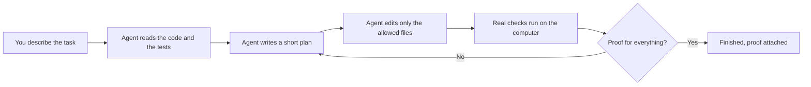

# GEMINEX

Gives Gemini Claude-grade engineering discipline: read before writing, plan in proportion to risk, verify against executed evidence, and report only what the evidence supports.

GEMINEX is an open-source reliability runtime for AI coding agents. It ships as portable Agent Skills plus optional host enforcement (an Antigravity plugin and an OpenCode shim) backed by one policy engine. The goal is a coding workflow whose claims can be checked after the fact: scoped changes, executed validators, tamper-evident records, and a completion gate that refuses to pass on stale or missing proof.

GEMINEX changes the engineering process, not model weights.

[](https://github.com/mugenkyou/geminex/actions/workflows/geminex.yml) [](https://skills.sh/mugenkyou/geminex) [](LICENSE) [](docs/production-readiness.md)

> Research preview: comparative performance is not yet measured.

## Problem

Coding agents fail in predictable ways. They edit files they never read. They make broad changes for narrow tasks. They run no tests, or run them before the final edit and report the old green result. They retry the exact call that just failed. And they announce completion that no record supports. Each of these is a process failure, not a capability failure: the model could have done the right thing, but nothing in the loop required it.

Geminex puts those requirements into the loop. Six invariants state them. Skills teach them. Hooks and guards enforce the subset that can be checked mechanically. Validators produce the evidence. A gate reads the evidence before the session is allowed to stop.

## Why now

In late 2026, Google restricted third-party models in Antigravity on licensing grounds: Claude access is now reserved for direct, non-promotional paid subscriptions, and the Claude 4.6 models remaining on other plans are removed on November 2, 2026 ([models table](https://antigravity.google/docs/models/)). Users on promotional routes, including the free Jio tier and student plans, lost the Claude option they had built their workflows around.

What remains on every plan, Free included, is Gemini 3.8 Flash: a fast model built for agentic work, but one that still fails in exactly the predictable ways listed above when nothing constrains its process. That is the opportunity inside the disruption. Geminex does not bring Claude back. It gives the model you still have the working discipline people miss about Claude: grounded edits, declared scope, executed proof, and no completion without evidence.

## Installation

Three setups, in order of increasing machinery. All three share the same six invariants.

**Core.** Portable behavioral policy delivered as Agent Skills. No enforcement, no dependencies beyond the skill files. This is the recommended default.

```bash
npx skills add mugenkyou/geminex --skill geminex --agent antigravity --yes
```

*(Note: `--skill gravitas` continues to be supported for backward compatibility).*

Then address the agent directly:

```text
Use Geminex to fix this bug and verify the result.
```

**Native.** Core plus an Antigravity plugin (`geminex-native`) with PreToolUse, PostToolUse, PostInvocation, and Stop hooks. For teams that want tool calls checked and completion gated by the runtime rather than by instruction alone.

```bash
git clone --depth 1 https://github.com/mugenkyou/geminex.git
cd geminex
bash scripts/build-native-bundle.sh
agy plugin install "$PWD/dist/geminex-antigravity"
agy plugin validate "$PWD/dist/geminex-antigravity"
```

**OpenCode.** Core plus a permission profile and a `tool.execute.before` shim (`geminex guard`) that applies the same policy engine to OpenCode tool calls.

```bash
geminex init --host opencode --profile balanced
```

Detailed instructions, update paths, and uninstall steps are in [docs/install.md](docs/install.md). First tasks are in [docs/quickstart.md](docs/quickstart.md).

## The six invariants

These are the entire contract. Everything else in the repository implements them.

| # | Invariant | Consequence |
|---|---|---|
| 1 | Ground before mutating | The agent reads the target, its tests, and its callers before editing. File state is observed, never assumed. |
| 2 | Stay in declared scope | Each task declares `allowed_write_scope`. Writes outside it are denied. A wrong scope is amended openly, not routed around. |
| 3 | Completion needs evidence | A criterion is complete only when a Geminex-owned validator passed after the last relevant mutation. Prior green runs, self-review, and prose summaries do not count. |
| 4 | Never exact-retry a failure | A failed approach may be retried only after the diagnosis, context, or strategy changes. Byte-identical retries are blocked; `geminex resolve-failure` re-arms a fingerprint once a transient cause is resolved. |
| 5 | Satisfy the contract | Acceptance criteria and their required validators gate completion. A passing test suite for unrelated code proves nothing about the task. |
| 6 | Say what you cannot verify | Claims without backing are labeled as such. Uncertainty lowers confidence instead of being rounded up to certainty. |

Planning effort follows risk, not ritual. `geminex decide --signals '{...}'` emits a machine-readable record (`direct`, `compact`, `deep`, `replan`) with reason codes. A one-line fix in one file is `direct`. An auth migration across twelve files is `deep` with a reviewer. The profiles `eco`, `balanced`, `deep`, and `team` set intended process cost. None of them claims a performance advantage; that awaits measured comparison.

## How it works

The whole system is one loop, in plain words:



And here is the honest difference. Gemini alone is capable of every good practice below; the difference is that nothing requires them, checks them, or keeps the receipts. Geminex makes each step required and verifiable.

| Stage | Gemini alone (what actually happens) | Gemini plus Geminex |
|---|---|---|
| Reading code | Usually reads the relevant files, but nothing stops a blind edit when context is long or the model is confident. | Read-before-write is enforced: editing an existing file without a recorded read is denied. |
| Planning | Plans when it judges the task needs one. No record survives the session. | A machine-readable plan (`direct` to `replan`) is emitted with reason codes and stored; effort scales with risk and blast radius. |
| Scope | Can touch any file the tools allow. A wrong turn edits the wrong package. | Each task declares `allowed_write_scope`. Outside writes are denied with the violating path named. |
| Running checks | Often runs tests, sometimes before the final edit, and reports the result in prose you cannot re-run. | A declared validator executes after the last mutation; its exit code and output hash are recorded. A PASS from before the final edit is stale and rejected. |
| Retrying failures | Happily retries the identical call that just failed, burning quota. | An exact retry of a failed fingerprint is banned until the diagnosis, context, or strategy changes. |
| Claiming completion | Announces done. Nothing re-checks the claim. | The Stop gate demands a fresh owned PASS per criterion over an intact evidence chain. If proof is missing after bounded retries, the session ends marked unverified, never passed. |
| When something breaks | The error sits somewhere in the chat history. | Every denial and failure states what failed, which component decided, and the next safe action. |

## Enforcement semantics

Instruction is not enforcement, so the repository distinguishes the two everywhere. What the skill asks for and what the runtime guarantees are documented separately per host.

| Capability | Core (any host) | Native (Antigravity) | OpenCode |
|---|---|---|---|
| Planning and read-before-write policy | Instruction | Instruction plus action lock | Instruction plus permission profiles |
| Write and scope gating | None | Hook deny | Shim deny plus host permissions |
| Destructive confirmation | None | `force_ask` | Hard deny (no ask channel exists) |
| Evidence ledger | None | Automatic, hash-linked | Manual, via CLI |
| Completion gate | None | Automatic Stop hook | Manual (`summarize` plus evidence) |
| Session isolation | None | Per conversation | Per workspace contract |
| Guard dependency | None | None (in-process) | python3 plus `geminex` on PATH |

The failure policy is fail-closed. An unreachable, slow, or broken guard denies mutating calls. A missing or corrupt contract denies mutations while still permitting reads (reported as `unconfigured` or `degraded`, never as silent permission). A hook payload that cannot be parsed blocks rather than passes. Host differences, stated without softening, are in [docs/hosts.md](docs/hosts.md).

What enforcement is not: hooks are workflow controls, not an operating-system sandbox. The shell classifier described below is a conservative capability estimate, not filesystem containment. Full limits are in [SECURITY.md](SECURITY.md).

## Evidence model

Completion-grade evidence has a precise definition: a record produced by a Geminex-owned execution (`validator_runner.py`), naming a declared validator and criterion, carrying exit code 0, timestamped strictly after the latest file write in the ledger, and sitting in an intact hash chain. Anything weaker (hook telemetry, reproducer output, prose) is recorded as supporting context and cannot satisfy the gate.

Three mechanisms protect this definition. First, the Stop gate verifies chain integrity before reading any verdict, so edited or reordered ledger lines refuse completion instead of passing it. Second, freshness is recomputed from the ledger on every run; a file write after a PASS returns the criterion to pending until a new PASS lands. Third, validator identity is bound: the executed command must equal the contract declaration, the criterion must be assigned to that validator, and timeouts or interruptions record FAIL, never PASS. Output is capped and hashed digest-only so verbose tools cannot exhaust the runner.

Hash chains make silent edits detectable; they do not stop an attacker who can rewrite the whole ledger. The model assumes filesystem integrity and states so.

## Shell classification

Shell strings are classified by tokenizer plus operator scan into five capability levels. The classifier is deliberately pessimistic: unknown executables, unparsable segments, wrappers (`sudo`, `env`, `VAR=` prefixes), newlines, `sh -c` payloads, and `xargs` tails all resolve against the inner command, worst segment wins.

| Level | Meaning | Examples |
|---|---|---|
| none | Provably read-only query | `git status`, `ls`, `sed` without `-i`, `git -C dir status` |
| write | Scoped file mutation | `write_to_file` inside allowed scope |
| mutation | Code execution or unenumerable writes | `pytest`, `python3 -c`, pipelines, redirects |
| destructive | Deletion, blind overwrite, infra, exfiltration | `rm -rf`, `git branch -D`, `find -execdir rm`, `curl … | sh` |
| unknown | Unclassifiable | Fails closed to mutation at minimum |

Quoted separators are a known over-approximation (`echo "a;b"` classifies as mutation). That direction is safe and documented; precise quote-aware splitting is deferred work, listed in the audit.

## Verification

The suite currently holds tests covering action locking, a shell-bypass corpus, scope and path-traversal checks, session isolation, evidence tampering, stale-gate behavior, packaging integrity, CLI integration, and deterministic fuzzing. Reproduce locally:

```bash
python -m unittest discover -s tests
```

The full gate, as run by CI on Python 3.9 and 3.12, is:

```bash
python -m unittest discover -s tests
python benchmarks/runner/audit.py
python benchmarks/runner/validate.py --episodes benchmarks/results --allow-empty
python -m py_compile geminex_cli.py geminex_init.py plugins/geminex-antigravity/scripts/*.py
python .github/scripts/validate_skill.py
python scripts/check_readme_claims.py
bash scripts/build-native-bundle.sh
```

A clean wheel install plus external-workspace init is smoke-tested from an isolated virtualenv (both skills land, `opencode.json` merges without clobbering). The installed `agy plugin validate` passes on the canonical plugin and the generated bundle.

## Star History

<br />

[](https://star-history.com/#mugenkyou/geminex&timeline)

<br />

## Benchmark status

GeminexBench (formerly GravitasBench) currently holds **30 registered task specifications across 10 planned lanes**: task design, schemas, a runner, and smoke fixtures. That is infrastructure, not results. No solve rates, no requirement-coverage numbers, no token or latency comparisons, and no model rankings are published, because the preconditions for a credible comparison do not exist yet: pinned tasks, hidden independent validators, identical task sets across baseline and treatment, fixed model and host revisions, repeated runs in clean isolation, recorded failures, and reported overhead with uncertainty. Until then, every performance statement in this repository is a hypothesis with its status labeled. Methodology and release gates: [docs/benchmark.md](docs/benchmark.md), [docs/production-readiness.md](docs/production-readiness.md). The latest hardening audit, with reproductions and residual limitations, is [docs/audits/v5-audit.md](docs/audits/v5-audit.md).

## Related work

Each source below motivates one mechanism. None of them establishes an effect size for Geminex; they are cited for the design reasoning they support, which [docs/research.md](docs/research.md) separates from project hypotheses.

- [ReAct](https://openreview.net/forum?id=WE_vluYUL-X): grounding reasoning in actions and observations. Motivates invariant 1 (observed file state before editing).
- [Plan-and-Solve](https://aclanthology.org/2023.acl-long.147/): explicit decomposition for multi-step tasks. Motivates contracts plus the adaptive planning record; applying it to coding workflows is the project hypothesis.
- [Huang et al.](https://openreview.net/forum?id=IkmD3fKBPQ): unaided self-correction fails on the studied reasoning tasks. Motivates invariant 3 (external validators over self-review).
- [SWE-bench](https://openreview.net/forum?id=VTF8yNQM66): judge repository state, not final prose. Motivates executed validators and the completion gate.
- [Harness-Bench](https://arxiv.org/abs/2605.27922) and [Harness-IF](https://arxiv.org/abs/2608.11727): evaluate model-plus-harness configurations as systems, with stated methodology. This is the standard the benchmark track holds itself to before publishing any comparison.

## Limitations

Stated plainly, so nobody discovers them in production: Native hooks do not sandbox processes. The OpenCode V1 runtime is unvalidated here and its schema differs from V2. No live model-backed OpenCode run has been performed (it would spend paid quota). Read-before-write tracking in the OpenCode adapter is per call, so existing-file writes deny until session read tracking exists. Concurrent sessions are isolated by directory and conversation hash, not by OS controls. Anything above that you need is out of scope until documented otherwise.

## Documentation

[Quickstart](docs/quickstart.md) · [Concepts](docs/concepts.md) · [Hosts](docs/hosts.md) · [Configuration](docs/configuration.md) · [Benchmark methodology](docs/benchmark.md) · [Install and troubleshooting](docs/install.md) · [Contributing](docs/contributing.md) · [Security policy](SECURITY.md) · [Research foundations](docs/research.md) · [Architecture decisions](docs/adr/)

## Contributing

Useful contributions, in rough order of value: licensed benchmark tasks, hidden deterministic validators, live host compatibility checks, privacy review, independent replications. Working agreement is in [CONTRIBUTING.md](CONTRIBUTING.md): read before writing, keep changes reviewable, add a regression test per confirmed bug, verify with executed output.

## Citation

Use [CITATION.cff](CITATION.cff) and pin a commit until a versioned release and archived benchmark dataset exist.

## License

[MIT](LICENSE) © GEMINEX Contributors.
